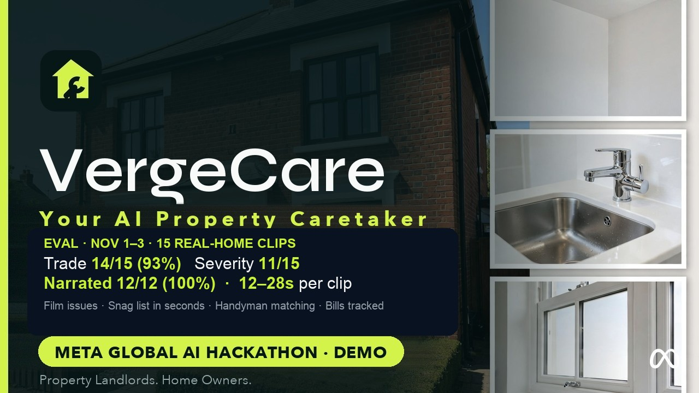
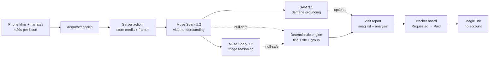
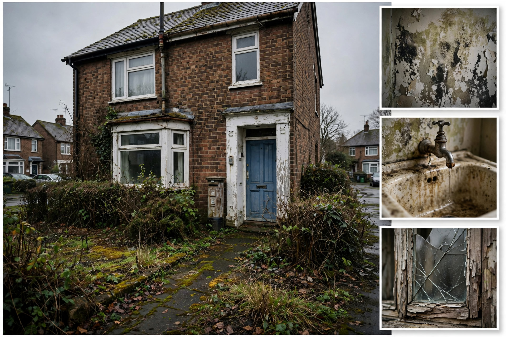
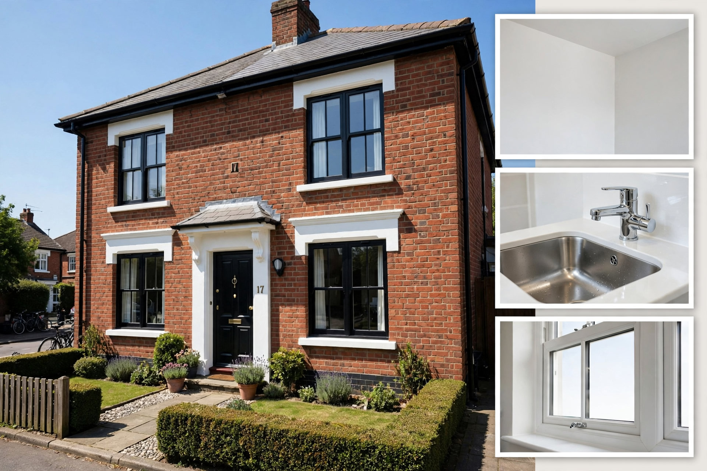
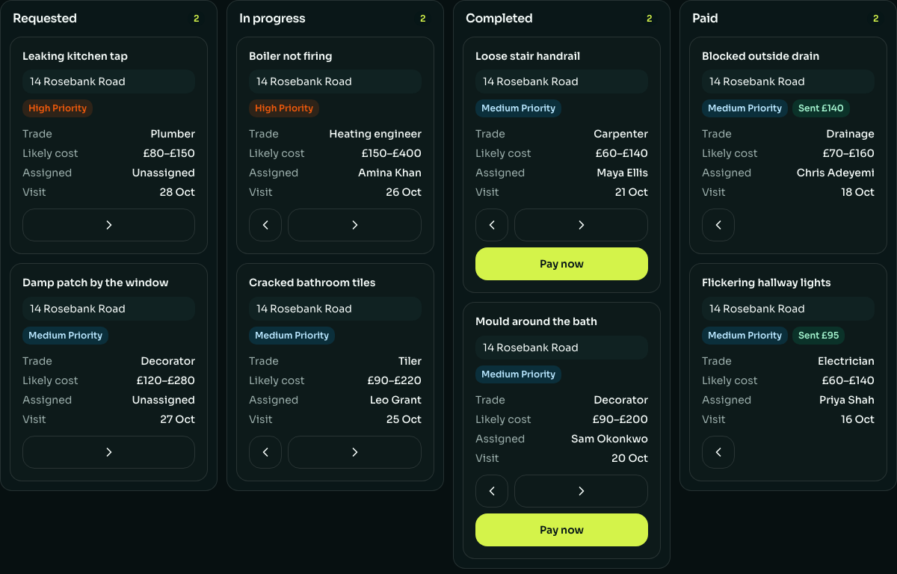

# VergeCare(Beta) — Your AI Property Caretaker

> Film a repair issue, narrate what you see, and get a costed snag list plus an Issues & Bills Tracker Board in under a minute — every visit remembered.

[](LICENSE)

Built for the **Meta AI Global Hackathon 2026** — **Indie track**.
**Category:** Business, Finance & Operations · Multimodal end-to-end agentic AI.

**Live product demo:** https://demo-vergecare.goverge.app/request
(hosted VergeCare Beta — this repo is the source-available build of the same app) ·
**Create yours:** https://demo-vergecare.goverge.app/request ·
**VergeCare Demo (Beta)- Meta Global AI Hackathon 2026:** https://youtu.be/aHLs56BK9LY

[](https://youtu.be/aHLs56BK9LY)

## At a glance for judges

| Criterion | Where the evidence is |
|---|---|
| **Impact (30%)** — real-world potential, who benefits, problem fit | Property repairs die in chat threads while damp and disrepair compound. VergeCare turns one filmed check-in into a costed snag list and a bills-to-paid board for landlords, homeowners, managers and tenants. See [The problem](#the-problem) and [What it does](#what-it-does). |
| **Meta AI tooling (25%)** — creative use beyond a basic integration | Two Muse Spark passes per clip (video understanding, then text-only triage reasoning) plus SAM 3.1 damage grounding, all through the Meta Model API — with a deterministic engine underneath so every session is filed even when AI is unavailable. See [Meta AI tooling](#meta-ai-tooling). |
| **Technical depth (20%)** — sound, refined engineering | Next.js 15 + TypeScript, 120 unit tests (19 files, vitest, all passing) plus an automated end-to-end script, typecheck + lint + secrets gates, mobile-first adaptive UI. See [Engineering depth](#engineering-depth) and [Architecture](#architecture). |
| **Demo (25%)** — working product, live, video | Live deployment, demo video above, one-command local quickstart that runs with no API keys, and a 5-minute seeded demo path. See [Quickstart](#quickstart) and [Demo in 5 minutes](#demo-in-5-minutes). |

## The problem

Landlords, homeowners, property managers and tenants all lose repair issues the
same way: a tenant films damp on WhatsApp, the clip scrolls away, the plumber
never gets booked, and the wall gets worse. Bills are chased across the same
lost threads. Across one home or a whole portfolio, the property itself keeps
no memory — every visit starts from zero.

VergeCare gives the property a memory. One filmed check-in becomes an
organized Issues snag list (trade, severity, likely cost on every issue) and
an Issues & Bills Tracker Board that follows each fix from Requested to Paid.
No accounts, no passwords for the people watching a repair move: the board
travels on a magic link.

## What it does

1. **Check in** — show VergeCare around the property. Film one short clip per
   issue (≤20 s each) and narrate what you see as you film.
2. **Get your snag list** — seconds later, every issue is listed with its
   trade, severity grade and likely UK cost band.
3. **Track it to Paid** — the property's board moves each card Requested → In
   progress → Completed → Paid; recording an amount marks the bill.
4. **Remember everything** — every clip, report and bill stays with the
   property, visit after visit.

## Meta AI tooling

Every clip runs a three-stage Meta pipeline through the Meta Model API
(`https://api.meta.ai`), using two Meta model families:

| Stage | Model | What it returns |
|---|---|---|
| 1. Video understanding | `muse-spark-1.2` | Verbatim speech transcript, 2–3 sentence visual description of the damage, the trade (1 of 16, from plumber to roofer), and the damaged object in 1–3 words |
| 2. Triage reasoning | `muse-spark-1.2` (text-only, cheap) | Severity grade (`low` / `medium` / `high`) plus a rough UK handyman cost band (e.g. £40–£120) for landlords |
| 3. Damage grounding | `sam-3.1` | Up to 3 normalized bounding boxes around the named damage on a still frame |

Beyond a basic integration:

- **Two-pass reasoning, not one prompt.** Perception (stage 1) is separated
  from judgement (stage 2), so triage stays cheap, structured (`severity` +
  `cost_band` JSON) and landlord-specific.
- **Vision that points.** SAM 3.1 grounds the Spark-named object to regions on
  the frame, so the report shows *where* the damage is, not just what it is.
- **Agentic handoffs with human approval.** AI proposes the trade and cost;
  the tradesman confirms or corrects them, and the owner approves handyman
  and price before work starts.
- **Graceful by design.** Every Meta call is null-safe: if a pass fails or no
  API key is set, the deterministic engine (`src/lib/media-inference.ts`,
  `media-rules.ts`, `report-sections.ts`) still titles, files and groups
  every session. The product never dead-ends on AI.

## Architecture



## Screenshots

Neglected house before check-in:



The same property cared for after:



The Issues & Bills Tracker Board:



## Engineering depth

- **Stack:** Next.js 15 + React 19 + TypeScript, Tailwind CSS v4,
  PostgreSQL 16 via Drizzle ORM. Web only, port **3002** (avoids clashing
  with apps on 3000/3001).
- **120 unit tests, 19 files** (vitest, all passing): payments, board flow,
  sessions, report sections, media inference, email.
- **Automated end-to-end:** `pnpm test:e2e` submits a check-in against a
  running server, walks report → snag list → magic-link board, moves a card
  to Paid, then cleans up.
- **Golden-clip eval:** `pnpm eval` scores Spark trade/severity accuracy on
  human-labeled clips (see `eval/README.md`).
- **Gates:** `pnpm typecheck`, `pnpm lint`, `pnpm test`,
  `pnpm check:secrets` (fails the push if a Meta-style key or private key
  appears in tracked files).
- **Mobile-first:** single-column forms, 44px touch targets, native camera
  capture on phones degrading to pickers on desktop, horizontally scrolling
  board on narrow screens.

## Quickstart

Prerequisites: Node.js 20+, pnpm 9+, PostgreSQL 16 with a `vergecare`
database (`createdb vergecare`) — or `docker compose up -d` for the
isolated container on port 5433.

```bash
# 1. Install
pnpm install

# 2. Push schema + seed demo data
pnpm db:push
pnpm db:seed

# 3. Run (no API keys needed — AI blocks show as unavailable)
pnpm dev   # → http://localhost:3002
```

Full walkthrough (env keys, seed contents, click path) is in
[instruction.md](./instruction.md).

To enable live Meta analysis, add a key to `.env.local`:

```bash
META_MODEL_API_KEY=LLM_...
```

Duration (20 s) and the one-video rule are enforced in the browser before
submit, with a server-side backstop.

Prefer Docker for the app itself: `docker build -t vergecare .`, then run it
with `DATABASE_URL` pointing at your Postgres (see `.env.example`).

## Demo in 5 minutes

```bash
pnpm db:seed   # reset to the 6-check-in mock fixture
pnpm dev       # http://localhost:3002
```

1. Landlord: open `/request`, start a check-in, enter the address, film one
   ≤20 s video per issue narrating what you see, send.
2. Visit report at `/request/[id]` — sessions, Issues snag list, Meta Spark
   analysis.
3. Snag list at `/track` — every property's visits and sessions.
4. View Board from the report — the property's Issues & Bills Tracker
   Board; move a card through to Paid with Pay now.

Prefer watching? The [demo video](https://youtu.be/aHLs56BK9LY) walks the
same path end to end.

On desktop with no clips handy, download the base e2e test clip
([Google Drive](https://drive.google.com/file/d/1p7-j7FmEnigX8hcyw3_3Y5EYsvBroqC2/view?usp=sharing),
2MB, ~10s), then run the same journey headlessly against your running server:

```bash
VIDEO_PATH=~/Downloads/vergecare-e2e-test-clip.mp4 pnpm test:e2e
```

This submits one real check-in, asserts the Meta transcript, severity and
trade, walks the board to Paid, and cleans up afterwards. Add
`FRAME_PATH=~/still.jpg` (≤2MB) to also exercise SAM grounding; without it
SAM is skipped (the browser flow captures stills automatically). More
test clips live in the demo footage zip
([Google Drive](https://drive.google.com/file/d/1Zm9FlpDPe27eUYOts5ier8eIkeoWOJz1/view?usp=sharing)).

## Check-in flow

Check in → Visit report → Track → Board. A video is enough to submit: each
becomes a session — trade auto-detected, reference issued — grouped under
its visit on the visit report, with an Issues snag list and a Meta Spark
analysis block. `/track` holds every property's Issues snag list; from the
report, "View Board" opens the property's magic-link Issues & Bills Tracker
Board — no account, no password. Uploads stay on the machine under
`uploads/`.

## Magic-link email (optional)

With SES configured (`SES_FROM_EMAIL` + AWS credentials in `.env.local`),
View Board emails the landlord link and opens the board. Without it, the UI
says nothing was sent and still opens the board on-screen — the demo never
needs email.

## Public repo vs private build

This branch is the public source-available build. What differs from the
private full build:

- Deploy stack lives in the private repo only: production Dockerfile,
  Caddy, `deploy/` configs and scripts, AWS runbooks, Vercel project.
- Demo video masters (cinematic cut) are not in git; the README
  thumbnail lives in `public/images/`.

Everything user-facing — check-in, visit reports, Issues snag list,
magic-link Issues & Bills Tracker Board through Paid, payments, SAM
grounding — runs fully from this branch.

## Secrets rule

What can be pushed: all source, docs, and config. What stays local: API keys
and credentials in `.env.local` (gitignored), `*.pem` / `*.key` files, and
anything under `secrets/`. Run `pnpm check:secrets` before every push.

## Pre-submit test

Automated first (server must be running):

```bash
pnpm dev              # in one terminal → http://localhost:3002
pnpm test:e2e         # in another: submits a check-in, walks report →
                      # snag list → magic-link board, moves a card to Paid,
                      # cleans up
pnpm test             # unit tests
pnpm check:secrets    # must pass before every push
```

Then click through once in the browser (desktop + phone width): land →
check in with a real clip → confetti report → snag list → View Board →
moves to Paid with confetti. If the server ever stops responding, restart
`pnpm dev` (a huge raw gallery upload can wedge it — the in-app recorder
keeps clips small).

## License

Source-available under the Business Source License 1.1, © GoVerge Ltd —
see [LICENSE](./LICENSE). Any public use or redistribution must credit
"VergeCare by GoVerge Ltd" with a link to this repo.
